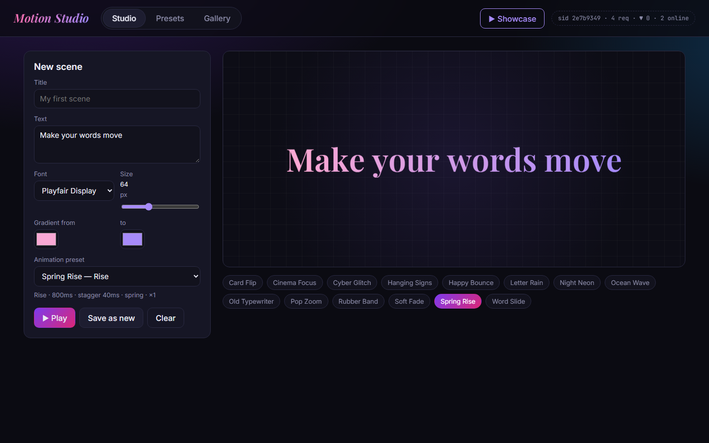
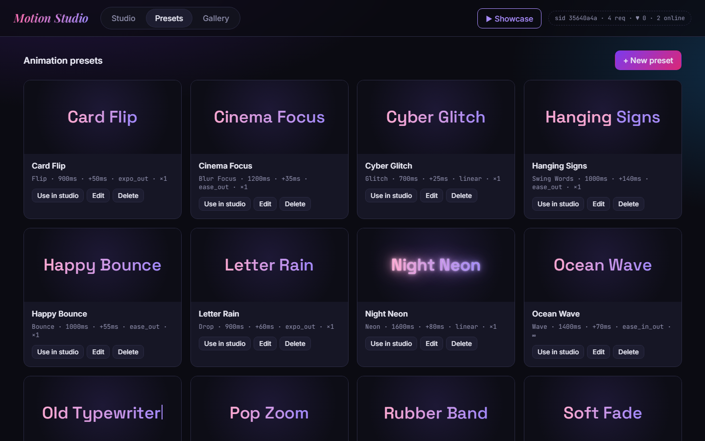
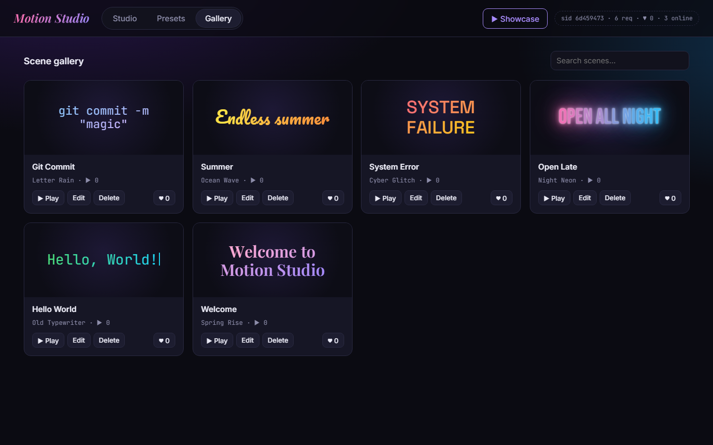

# Motion Studio

A small Spring Boot CRUD application built for **Laboratory 1 – Git Basics**.

Motion Studio is a playground for text animations. You write a piece of text, choose a font,
a color gradient and an **animation preset** (effect + timing), and watch the text appear on
the stage. Scenes are saved to the gallery and can be played one after another in a
fullscreen **Showcase** with transitions between them.



## Features

- **Presets (CRUD):** named animations built from 14 effects (Fade, Rise, Drop, Blur Focus, Zoom,
  Flip, Bounce, Elastic, Wave, Glitch, Neon, Typewriter, Swing Words, Slide Words), an easing curve,
  duration, delay, per-letter stagger and repeat count. A live preview updates while you edit.
- **Scenes (CRUD):** text + font + size + gradient + preset. Search, play counter and likes.
- **Sessions:** every visitor gets a server-side session (cookie `MS_SID`). It stores likes
  (one like per session) and the recently played scenes.
- **Showcase:** fullscreen slideshow of all scenes (`←` / `→` to navigate, `Esc` to close).
- **Request logging:** every API call is logged with a request id, status, duration and session.

## Tech stack

Java 17+, Spring Boot 3.5 (Web, Data JPA, Validation), H2 database (file `./data`),
vanilla HTML/CSS/JS frontend served by Spring Boot, JUnit 5 + MockMvc.

## Architecture

```
src/main/java/com/nazarkoldun/motionstudio
├── model/        JPA entities (AnimationPreset, Scene) and enums (EffectType, Easing, StudioFont)
├── repository/   Spring Data JPA repositories
├── service/      Business logic and validation rules (PresetService, SceneService)
├── api/          REST controllers, DTOs (records) and the global exception handler
├── session/      SessionManager (in-memory sessions, expiry) + SessionFilter (cookie middleware)
├── middleware/   RequestLoggingFilter (request id, timing, access log)
└── config/       DataSeeder (starter presets and scenes)
```

All components are Spring beans, i.e. **singletons**. A request goes through:
`RequestLoggingFilter → SessionFilter → Controller → Service → Repository → H2`.

## REST API

| Method | Path                       | Description                               |
|--------|----------------------------|-------------------------------------------|
| GET    | `/api/meta`                | Effects, easings and fonts for the forms  |
| GET    | `/api/presets`             | List presets                              |
| GET    | `/api/presets/{id}`        | Get one preset                            |
| POST   | `/api/presets`             | Create a preset                           |
| PUT    | `/api/presets/{id}`        | Update a preset                           |
| DELETE | `/api/presets/{id}`        | Delete a preset (409 if used by a scene)  |
| GET    | `/api/scenes?q=`           | List / search scenes                      |
| GET    | `/api/scenes/{id}`         | Get one scene                             |
| POST   | `/api/scenes`              | Create a scene                            |
| PUT    | `/api/scenes/{id}`         | Update a scene                            |
| DELETE | `/api/scenes/{id}`         | Delete a scene                            |
| POST   | `/api/scenes/{id}/play`    | Count a play, remember it in the session  |
| POST   | `/api/scenes/{id}/like`    | Like / un-like (once per session)         |
| GET    | `/api/session`             | Current session info                      |

Validation errors return `400` with `fieldErrors`, missing entities `404`, conflicts `409`.

## Running locally

Requirements: **JDK 17 or newer** (Maven is not needed, the wrapper downloads it).

```bash
# Windows
mvnw.cmd spring-boot:run
# Linux / macOS
./mvnw spring-boot:run
```

Open <http://localhost:8080>. The H2 console is at <http://localhost:8080/h2-console>
(JDBC URL `jdbc:h2:file:./data/motionstudio`, user `sa`, empty password).

Run the tests with `mvnw.cmd test` / `./mvnw test`.

## Screenshots

See the [`doc`](doc) directory.

| Presets | Gallery |
|---------|---------|
|  |  |
